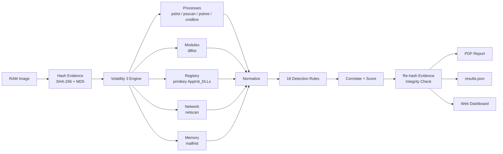

<div align="center">

# MemTrace

### Automated Windows Memory Forensics Analyzer

**Upload a RAM image. Get a forensic verdict, the evidence behind it, and a court-ready PDF report in minutes.**


</div>

---

## Table of Contents

- [Overview](#overview)
- [Why Memory Forensics](#why-memory-forensics)
- [Key Capabilities](#key-capabilities)
- [How It Works](#how-it-works)
- [Detection Coverage](#detection-coverage)
- [Verdict and Risk Scoring](#verdict-and-risk-scoring)
- [Case Study: Detecting the R2D2 Trojan](#case-study-detecting-the-r2d2-trojan)
- [Validation](#validation)
- [Quick Start](#quick-start)
- [Usage](#usage)
- [Case Output](#case-output)
- [The Forensic Report](#the-forensic-report)
- [Forensic Principles](#forensic-principles)
- [Project Structure](#project-structure)
- [Supported Images](#supported-images)
- [Troubleshooting](#troubleshooting)
- [Limitations](#limitations)
- [Roadmap](#roadmap)
- [Technology Stack](#technology-stack)
- [License](#license)

---

## Overview

When a machine is compromised, its RAM holds the most honest record of what was running: every process, loaded library, network connection and injected payload. Reading that record takes a lot of skill. An analyst has to run dozens of Volatility commands, cross-reference thousands of lines of output, and know which of them matter.

**MemTrace automates that first triage pass.** It runs a curated set of Volatility 3 plugins against a Windows memory image and combines their results. It then applies 18 detection rules built on real attacker techniques, correlates related findings, and produces three things:

- a **verdict** (`Compromised`, `Likely Compromised`, `Suspicious`, or `No Significant Findings`), with a risk score from 0 to 100
- **evidence-backed findings** mapped to MITRE ATT&CK, each with a plain-language explanation and a recommended action
- a **forensic PDF report** that records evidence hashes, the analysis environment and the methodology

MemTrace speeds up the investigator's work. It does not replace the investigator. Every finding links to the raw evidence that produced it, so you can verify each conclusion yourself.

---

## Why Memory Forensics

| Disk forensics sees... | Memory forensics also sees... |
|---|---|
| Files written to disk | **Fileless malware** that only lives in RAM |
| Programs installed on the system | Programs **actually running** at capture time |
| What a process claims to be | What is **injected inside** a legitimate process |
| Process lists returned by the OS | Processes **hidden by rootkits** from the OS |
| Encrypted or packed binaries | Payloads **decrypted and unpacked** in memory |
| Historical network logs, if any | **Live network connections** and their owning process |

Malware can avoid the disk, hide from Task Manager and encrypt itself. To run, though, it has to be in memory.

---

## Key Capabilities

| Capability | Description |
|---|---|
| **Automated Triage** | Runs 10 Volatility 3 plugin passes and normalizes their output into one data model |
| **Hidden Process Detection** | Compares the kernel's active process list with pool scanning to expose processes unlinked by rootkits |
| **Process Anomaly Analysis** | Finds masquerading names, abnormal parent-child relationships, duplicated critical processes, system binaries in the wrong path, and malicious command lines |
| **Module and Persistence Analysis** | Reads `AppInit_DLLs` directly from the in-memory registry, tracks which processes loaded each DLL, and detects look-alike library names |
| **Code Injection Detection** | Classifies every executable-writable memory region and separates injected PE images and shellcode from benign Windows artifacts |
| **Network Analysis** | Flags Internet traffic from processes that should never talk to the Internet, and connections on backdoor or C2 ports |
| **Cross-Source Correlation** | Escalates a process when independent sources agree, for example injection and network activity in the same process |
| **Evidence Integrity** | Computes SHA-256 and MD5 before and after analysis, and reports any change as an integrity failure |
| **Forensic PDF Report** | Executive summary, detailed findings, process listing, network artifacts, methodology and limitations |
| **Web Interface** | Upload or select evidence, follow live progress, browse findings and download the report |
| **Command-Line Interface** | Scriptable analysis for batch processing and automation |
| **Low False-Positive Design** | Recognizes heap headers, empty regions, Windows x64 RPC/COM thunks, JIT engines and acquisition tools, so analysts are not buried in noise |

---

## How It Works



### Pipeline Stages

1. **Evidence intake.** The image is hashed with SHA-256 and MD5 before anything else touches it.
2. **Extraction.** Each Volatility plugin runs in an isolated subprocess and renders JSON. If one plugin fails, the rest of the analysis still runs, and the failure is recorded in the report.
3. **Normalization.** Process lists from three sources are merged, and command lines, paths and loaded modules are attached to each process.
4. **Detection.** Rules check each artifact category for known attacker techniques.
5. **Correlation.** Findings that describe the same process are combined, and the severity is escalated when the evidence is mutually reinforcing.
6. **Scoring.** A verdict and a risk score are computed from the highest severity found.
7. **Integrity verification.** The image is hashed again to show it was not modified.
8. **Reporting.** The PDF report, the structured JSON and the raw plugin output are written to a dedicated case folder.

### Plugins Used

| Plugin | Forensic Purpose |
|---|---|
| `windows.info` | Identifies the OS version, architecture, build and capture time |
| `windows.pslist` | Walks the kernel's active process list, which is the view the OS itself reports |
| `windows.psscan` | Scans raw memory for process structures, including unlinked or terminated ones |
| `windows.pstree` | Reconstructs the parent-child hierarchy and image paths |
| `windows.cmdline` | Recovers the exact command line used to launch each process |
| `windows.dlllist` | Lists every module loaded into every process |
| `windows.netscan` | Recovers TCP/UDP endpoints and their owning process (Vista and later) |
| `windows.malware.malfind` | Finds private memory regions that are both writable and executable |
| `windows.registry.printkey` | Reads `AppInit_DLLs` (native and WOW64) from registry hives cached in memory |

---

## Detection Coverage

### Process Analysis

| Rule | Severity | What It Detects | MITRE ATT&CK |
|---|---|---|---|
| `HIDDEN_PROCESS` | High | Process found by pool scanning but unlinked from the active process list | T1014, T1564 |
| `UNEXPECTED_PARENT` | High | Core process with the wrong parent, e.g. `lsass.exe` not started by `wininit.exe` | T1036 |
| `MULTIPLE_INSTANCES` | High | More than one `lsass.exe`, `services.exe`, `wininit.exe` or `lsm.exe` | T1036.005 |
| `NAME_MASQUERADING` | High | Look-alike process names: `scvhost.exe` (transposition), `svch0st.exe` (homoglyph), `lsasss.exe` (insertion) | T1036.005 |
| `SYSTEM_BINARY_WRONG_PATH` | High | Core Windows binary running from outside `System32` | T1036.005 |
| `SUSPICIOUS_CHILD` | High | Office, PDF reader or browser spawning `cmd`, `powershell`, `mshta`, `rundll32` or similar | T1204, T1059 |
| `SUSPICIOUS_CMDLINE` | High | Encoded PowerShell, download cradles, hidden windows, execution-policy bypass | T1059.001, T1027 |
| `USER_WRITABLE_PATH` | Medium | Executable running from Temp, AppData, Downloads, Public or ProgramData | T1204.002 |
| `ACQUISITION_TOOL` | Info | DumpIt, WinPmem, RamCapture and similar tools identified as the responder's capture tool | - |

### Module and Persistence Analysis

| Rule | Severity | What It Detects | MITRE ATT&CK |
|---|---|---|---|
| `APPINIT_DLL_LOADED` | Critical | DLL from `AppInit_DLLs` actually mapped into running processes | T1546.010, T1055.001 |
| `APPINIT_DLLS` | High | `AppInit_DLLs` persistence configured in the registry | T1546.010 |
| `DLL_MASQUERADING` | High | Loaded module whose name imitates a Windows library, e.g. `mfc42ul.dll` vs `mfc42u.dll` | T1036.005 |

### Code Injection Analysis

| Rule | Severity | What It Detects | MITRE ATT&CK |
|---|---|---|---|
| `INJECTED_PE` | Critical | Executable image (MZ header) in private RWX memory: reflective DLL injection or process hollowing | T1055.001, T1620 |
| `RWX_MEMORY` | Medium | Private RWX region containing code in a process that has no reason to generate code | T1055 |
| `RWX_MEMORY_LOW_CONFIDENCE` | Low | RWX regions classified as empty, heap, sparse data, Windows x64 RPC/COM thunks, or JIT output in browsers, .NET, Java or antimalware engines | T1055 |

### Network Analysis

| Rule | Severity | What It Detects | MITRE ATT&CK |
|---|---|---|---|
| `UNEXPECTED_NETWORK_PROCESS` | High | Public-Internet connection from `explorer.exe`, `lsass.exe`, `notepad.exe`, script hosts and similar | T1071, T1055 |
| `SUSPICIOUS_PORT` | Medium | Traffic on 4444, 1337, 6666-6669, 31337, 9001, 9050 and other backdoor, IRC or Tor ports | T1571 |

### Correlation

| Rule | Severity | What It Detects | MITRE ATT&CK |
|---|---|---|---|
| `INJECTION_WITH_NETWORK` | Critical | The same process shows both code injection and suspicious network activity, the signature of banking trojans and RAT implants | T1055, T1071 |

---

## Verdict and Risk Scoring

The verdict is set by the **highest severity** present. The score is placed inside that severity's band and moves up as more supporting findings are found.

| Highest Severity | Verdict | Score Band |
|---|---|---|
| Critical | **Compromised** | 90 - 100 |
| High | **Likely Compromised** | 70 - 89 |
| Medium | **Suspicious** | 40 - 69 |
| Low | No Significant Findings | 10 - 39 |
| Info / none | No Significant Findings | 0 - 9 |

With banded scoring, a pile of low-confidence noise can never add up to a "Compromised" verdict. Only a real critical finding can.

---

## Case Study: Detecting the R2D2 Trojan

The public `0zapftis.vmem` image comes from a Windows XP machine infected with **R2D2**, a surveillance trojan also known as 0zapftis. This case shows why one detection technique is not enough.

**Step 1: Classic injection scanning finds nothing.**
`malfind` reported 12 RWX regions in `winlogon.exe` and `csrss.exe`. When MemTrace inspected them, they were all zero-filled reservations or Windows heap headers, normal on Windows XP. MemTrace rated them low confidence. `explorer.exe`, the trojan's known target, had **no** RWX regions at all.

**Step 2: The registry reveals the persistence.**
Reading the SOFTWARE hive from memory showed:
```
HKLM\Software\Microsoft\Windows NT\CurrentVersion\Windows
    AppInit_DLLs = mfc42ul.dll        (last written 2011-10-10 16:56:35 UTC)
```

**Step 3: The module list shows the impact.**
`dlllist` showed `C:\WINDOWS\system32\mfc42ul.dll` loaded into **15 processes**, including `explorer.exe`, `lsass.exe`, `services.exe` and every `svchost.exe`.

**Step 4: The name exposes the disguise.**
`mfc42ul.dll` is one extra character away from the legitimate Microsoft library `mfc42u.dll`.

**MemTrace verdict:**
```
Verdict:    Compromised
Risk score: 100/100
  F-001 [CRITICAL] AppInit DLL mfc42ul.dll loaded into 15 processes
  F-002 [HIGH    ] AppInit_DLLs registry value configured: mfc42ul.dll
  F-003 [HIGH    ] Look-alike DLL mfc42ul.dll resembles mfc42u.dll
  F-004 [LOW     ] Low-confidence executable memory in csrss.exe (PID 608)
  F-005 [LOW     ] Low-confidence executable memory in winlogon.exe (PID 632)
```

Three independent sources (registry, module list and naming analysis) point to the same artifact. The trojan used a legitimate Windows loading mechanism instead of raw code injection. A tool that relies only on `malfind` would have reported this machine as clean.

---

## Validation

MemTrace was validated against public training images whose ground truth is documented. The images were verified against their published hashes before analysis.

| Image | OS | Ground Truth | MemTrace Result | Analysis Time |
|---|---|---|---|---|
| `0zapftis.vmem` | Windows XP SP2 x86 (PAE) | Infected: R2D2 trojan | **Compromised** (100/100). Detected AppInit persistence, injection into 15 processes, and the look-alike DLL. | ~32 s |
| `MemoryDump_Lab1.raw` ([MemLabs Lab 1](https://github.com/stuxnet999/MemLabs)) | Windows 7 SP1 x64 | Clean, user activity only | **No Significant Findings** (13/100). Benign RWX regions classified correctly, DumpIt identified as the acquisition tool, network artifacts recovered. | ~1 min |

The rules were also exercised with a synthetic attack dataset. It covers hidden processes, look-alike processes, abnormal parents, malicious PowerShell, injected PE images, C2 connections and backdoor ports, and every process, injection, network and correlation rule fires as expected.

**False-positive tuning.** The first run on the clean Windows 7 image produced 14 high-severity false positives. Each one was investigated and resolved at its root cause:

| False Positive | Root Cause | Fix |
|---|---|---|
| 13 legitimate Windows 7 DLLs flagged as look-alikes (`wwapi.dll` vs `wuapi.dll`, etc.) | Edit distance alone is too broad | Only attacker naming techniques are flagged: homoglyphs, adjacent transposition, single-character insertion |
| `psxss.exe` flagged as imitating `smss.exe` | Same issue | Same fix |
| RWX code in `svchost`, `explorer`, `wmpnetwk` | Windows x64 RPC/COM call-forwarding thunks (`mov r10d; mov rax; jmp [rax]`) | Byte-pattern classifier for thunks |
| RWX code in `svchost -k secsvcs` | Antimalware engine JIT output | JIT-host awareness |
| `DumpIt.exe` running from Downloads | It was the responder's own acquisition tool | Acquisition tools are reported as Info |

---

## Quick Start

```bat
cd C:\MemTrace
python -m venv venv
venv\Scripts\activate
pip install -r requirements.txt
python app.py
```

Open **http://127.0.0.1:5000**, select a memory image, and click **Start Analysis**.

### Requirements

| Component | Requirement |
|---|---|
| OS | Windows 10/11 (tested). Linux and macOS should work but are untested. |
| Python | 3.11 or later |
| RAM | 8 GB minimum, 16 GB recommended for images larger than 4 GB |
| Disk | Free space of at least 2x the size of the images you analyze |
| Network | Internet access on the first analysis of each Windows build, so symbol tables can be downloaded from Microsoft |

### Recommended Setup

1. **Exclude `evidence\` from antivirus scanning.** Memory images contain live malware artifacts, and an antivirus product may quarantine or corrupt them.
2. **Keep originals read-only.** Copy images into `evidence\` and never edit them.
3. **Verify published hashes** before you analyze a downloaded image:
   ```bat
   certutil -hashfile evidence\image.raw SHA256
   ```

---

## Usage

### Web Interface

```bat
venv\Scripts\activate
python app.py
```

| Page | Purpose |
|---|---|
| **Home** | Upload a new image or select one from `evidence\`, and browse all previous cases |
| **Progress** | Live progress bar, refreshed automatically while plugins run in the background |
| **Case** | Verdict, severity counts, evidence hashes, system profile, expandable findings, process table, network table and plugin log |
| **Downloads** | PDF report and the full `results.json` |

The server binds to `127.0.0.1` only, so it is reachable from the analysis workstation alone.

### Command Line

```bat
python analyze.py evidence\0zapftis.vmem
```

```
Case MT-20261022-002428-3FBA  |  Evidence 0zapftis.vmem
[1/13] Hashing evidence (SHA-256, MD5)
[2/13] Running windows.info
...
[12/13] Running detection rules
[13/13] Generating PDF report

Verdict:    Compromised
Risk score: 100/100
Findings:   critical=1, high=2, medium=0, low=2, info=0
  F-001 [CRITICAL] AppInit DLL mfc42ul.dll loaded into 15 processes
  ...
Report:     C:\MemTrace\cases\MT-20261022-002428-3FBA\MT-20261022-002428-3FBA_report.pdf
```

Options:

| Argument | Description |
|---|---|
| `dump` | Path to the memory image |
| `--cases-dir` | Output directory for case folders (default: `cases\`) |

### Running Volatility Directly

`cmd.exe` has a built-in `vol` command that takes priority over Volatility. Use the full path:

```bat
venv\Scripts\vol.exe -f evidence\image.raw windows.pslist
```

---

## Case Output

Every analysis creates a self-contained case folder:

```
cases/MT-20261022-002428-3FBA/
├── MT-20261022-002428-3FBA_report.pdf   Forensic report
├── results.json                          Normalized data, findings, verdict
├── status.json                           Job state (web interface)
└── raw/                                  Unmodified Volatility output
    ├── info.json
    ├── pslist.json
    ├── psscan.json
    ├── pstree.json
    ├── cmdline.json
    ├── dlllist.json
    ├── netscan.json
    ├── malfind.json
    ├── appinit.json
    └── appinit_wow64.json
```

The `raw/` folder keeps the original output of every plugin, so a reviewer can trace any finding back to the exact data that produced it.

---

## The Forensic Report

| Section | Contents |
|---|---|
| **1. Executive Summary** | Verdict banner, risk score, severity breakdown, narrative summary and the top findings |
| **2. Evidence and Methodology** | File name, size, SHA-256, MD5, integrity result, analysis environment (tool and engine versions, timestamps), target system profile, methodology, and the plugin execution log |
| **3. Detailed Findings** | For each finding: ID, severity, category, rule, process, MITRE ATT&CK techniques, supporting evidence, explanation and recommended action |
| **4. Process Listing** | Every recovered process with its source (pslist or psscan) and flags. Suspicious rows are highlighted. |
| **5. Network Artifacts** | All recovered connections. Flagged rows are highlighted. |
| **6. Limitations** | The scope and confidence statement required for defensible reporting |

Two complete examples are included:

- [`docs/sample_report_0zapftis.pdf`](docs/sample_report_0zapftis.pdf): infected Windows XP machine (Compromised)
- [`docs/sample_report_memlabs_lab1.pdf`](docs/sample_report_memlabs_lab1.pdf): clean Windows 7 machine (No Significant Findings)

---

## Forensic Principles

MemTrace is built around the core requirements of digital forensics:

| Principle | Implementation |
|---|---|
| **Integrity** | The evidence is opened read-only and hashed before and after analysis. Any change is reported as **FAILED** in the report. |
| **Reproducibility** | Dependency versions are pinned, and the tool, engine and Python versions are recorded in every report. The same image produced identical results on separate workstations. |
| **Traceability** | Every finding cites its supporting evidence, and the raw plugin output is preserved with the case. |
| **Transparency** | Low-confidence observations are reported rather than hidden, and plugin failures appear in the report. |
| **Separation** | Original evidence (`evidence\`) and work products (`cases\`) are kept in separate locations. |
| **Safety** | MemTrace never executes code from the image. Extracted artifacts belong in an isolated sandbox. |

---

## Project Structure

```
MemTrace/
├── app.py                 Flask web interface and background job runner
├── analyze.py             Command-line interface
├── requirements.txt       Pinned dependencies
├── memtrace/
│   ├── engine.py          Volatility execution, JSON parsing, evidence hashing
│   ├── detection.py       Normalization, 18 detection rules, correlation, scoring
│   ├── pipeline.py        End-to-end case workflow and integrity verification
│   └── report.py          PDF report generation (ReportLab)
├── templates/             HTML templates (home, case, progress)
├── static/                Stylesheet
├── symbols/windows/       Bundled kernel symbol tables for legacy Windows
├── docs/                  Sample forensic reports
├── evidence/              Original memory images (read-only, not versioned)
└── cases/                 One folder per analysis
```

### Extending the Detection Rules

New rules are plain Python functions in `memtrace/detection.py`. A rule reads the normalized data and records findings:

```python
findings.add(
    "RULE_ID", "high", "Category",
    "Short title",
    "Why this matters to an investigator.",
    "What the investigator should do next.",
    ["T1234"], pid, process_name,
    {"Evidence Field": value},
)
```

New Volatility plugins are registered in the `PLUGINS` dictionary in `memtrace/engine.py`. Their output becomes available to the detection rules under the same key.

---

## Supported Images

| Item | Support |
|---|---|
| Formats | Raw memory images: `.raw`, `.mem`, `.vmem`, `.bin`, `.img`, `.dmp`, `.lime` |
| Operating systems | Windows XP through Windows 11, x86 and x64 |
| Validated on | Windows XP SP2 x86, Windows 7 SP1 x64 |
| Network analysis | Windows Vista and later (`netscan` does not support XP or Server 2003) |
| Acquisition tools | Any tool producing raw images: DumpIt, WinPmem, FTK Imager, Magnet RAM Capture, VMware `.vmem` |

---

## Troubleshooting

| Symptom | Cause | Solution |
|---|---|---|
| `The system cannot find the drive specified` when running `vol` | `cmd.exe` has a built-in `vol` command | Use `venv\Scripts\vol.exe` |
| `Symbol type not in symbol_table_name1 SymbolTable: _ETHREAD` | Microsoft serves stripped symbols for some legacy kernels | MemTrace bundles the full Windows XP SP2 PAE symbols. For other legacy kernels, copy the matching file from the official Volatility symbol pack into `symbols\windows\`. |
| `windows.netscan failed: This version of Windows is not supported` | `netscan` supports Vista and later only | Expected on XP/2003. The rest of the analysis continues. |
| `Volatility could not parse this image` | File is not a Windows memory image, is incomplete, or symbols could not be downloaded | Verify the image hash and check Internet access on the first run |
| Image disappears from `evidence\` | Antivirus quarantine | Add `evidence\` to the antivirus exclusions and restore the file |
| Analysis is slow on large images | Large images and limited RAM | Close other applications. Use a workstation with 16 GB of RAM or more for images over 4 GB. |
| `No module named 'Cryptodome'` in verbose output | Optional Volatility plugins for password extraction | Safe to ignore, because MemTrace does not use them |

---

## Limitations

- Findings are **investigative leads**. A qualified examiner must validate them before drawing conclusions.
- Detection is **heuristic**. Advanced malware, kernel rootkits and novel techniques may evade these rules.
- RWX code inside known JIT hosts (browsers, .NET, Java, antimalware engines) is reported as low confidence. Injection into those processes is only escalated when a PE header or corroborating findings are present.
- Memory is a **point-in-time** snapshot. Activity before or after the capture is not visible.
- A **clean result does not prove** that a system is uncompromised.
- Linux and macOS memory images are not supported yet.

---

## Roadmap

| Version | Planned Features |
|---|---|
| **1.1** | Validation on Windows 10/11 images, process hollowing detection (`hollowprocesses`), unlinked DLL detection (`ldrmodules`), suspicious services (`svcscan`) |
| **1.2** | Extraction of injected regions, YARA scanning, threat-intelligence lookups for remote IP addresses |
| **1.3** | Unified event timeline, HTML report export, case comparison |
| **2.0** | Linux and macOS images, multi-user deployment behind a production WSGI server, role-based access |

---

## Technology Stack

| Layer | Technology |
|---|---|
| Analysis engine | [Volatility 3](https://github.com/volatilityfoundation/volatility3) 2.28.2 |
| Language | Python 3.11+ |
| Web framework | Flask 3.1 |
| PDF generation | ReportLab 5.0 |
| Threat framework | MITRE ATT&CK |

---

## License

Proprietary software, delivered to the client under the terms of the engagement. See [`LICENSE`](LICENSE). Volatility 3 is distributed under the Volatility Software License, and the bundled symbol tables come from the Volatility Foundation symbol packs.

Public training images referenced in this document belong to their respective authors: [MemLabs](https://github.com/stuxnet999/MemLabs) and the [Volatility Foundation memory samples](https://github.com/volatilityfoundation/volatility/wiki/Memory-Samples).
